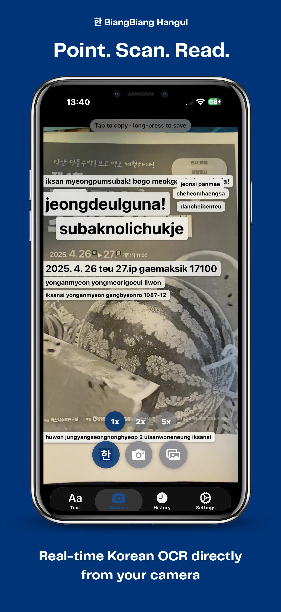

# BiangBiang Hangul


## Overview

한글 BiangBiang Hangul is an iOS and Android application that converts Hangul (Korean script) to its Revised Romanization and translates Korean text into any language. It includes OCR capabilities for recognizing Korean text from images, either live or from files.

This app has been developed using Swift and SwiftUI, leveraging the power of Apple's Vision framework for OCR functionality.

I developed this app to help myself and others learn Korean more effectively by providing an easy way to read and pronounce Hangul. It happened many times that I could not read a Korean sign or menu because I did not know how the characters were pronounced; but if I could see the romanization I would have been able to read it out loud. This app aims to solve that problem, aside from being a useful tool for learning Korean in general.

## Features

- [x] Convert Hangul to Revised Romanization
- [x] Translate Korean to any language
- [x] OCR support for images (both live and from camera)
- [x] OCR support from files

## Download

You can download 한글 BiangBiang Hangul from the App Store and from the Google Play Store.

[](https://apps.apple.com/app/id6782341879)
[](https://play.google.com/store/apps/details?id=dev.veeso.biangbianghangul)

> The iOS version is not yet published on the App Store.

## Required Tools

- [`swiftformat`](https://github.com/nicklockwood/SwiftFormat) — required for formatting iOS Swift code. Install via Homebrew:

  ```bash
  brew install swiftformat
  ```

## iOS

Format code using

```bash
swiftformat ./ios
```

Run `swiftformat ./ios` whenever iOS code is modified.

## License

This project is licensed under the Elastic V2 license. See the [LICENSE](./LICENSE) file for details.

## Gallery

Convert Hangul to its romanization and translate.


Recognize Hangul from live images and convert to its romanization.


